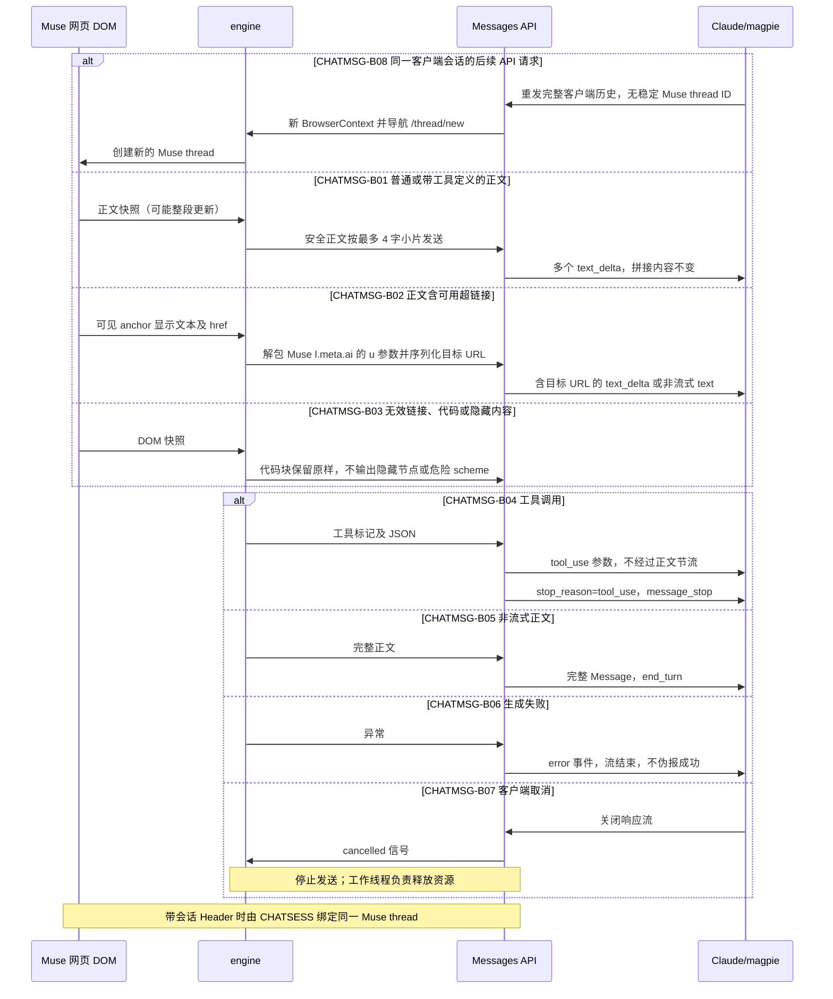

# Claude Messages 网页对话回传（CHATMSG）

## 概述

范围从网页助手气泡的正文快照提取，到 Anthropic Messages 输出；客户端渲染和外部 magpie 的缓冲策略是外部边界。本次用户要求：大块正文渐进显示、网页正文中的链接地址不能丢失。小块显示是呈现节奏，不代表 Muse 原生 token 时间。

## 时序图

## 分支表

| ID | 分支 | 状态 | 代码位置 | 测试 | 终态 / 下一步 | 不变量 | 确认方 |
|---|---|---|---|---|---|---|---|
| CHATMSG-B01 | 普通和带工具声明的大块正文分片 | done | app.py:2045; app.py:2111-2165 | tests/test_protocol_tool_calls.py::这是Muse一次性返回的大段正文 | end_turn / message_stop | 拼接等于正文；单个 DOM 大块最多约 2 秒节流；工具参数不进正文 | model:用户要求逐步显示；API text_delta 是展示分片，不等于 Muse 原生 token |
| CHATMSG-B02 | 正文超链接目标保留（含 Muse 跳转包装解包） | done | engine.py:1471-1512 | tests/test_chat_links_browser.py::PASS: visible links retain HTTP(S) targets | 真实目标 URL 到达正文 text；非 HTTP(S) URL 只保留可见文字 | l.meta.ai 仅接受合法 HTTP(S) 的 u 参数目标；同一 DOM 提取器用于轮询和最终快照 | model:浏览器 anchor href 是 l.meta.ai/?u= 包装，目标地址在 u 参数
| CHATMSG-B03 | 危险链接、代码、隐藏内容 | done | engine.py:1471-1512 | tests/test_chat_links_browser.py::PASS: visible links retain HTTP(S) targets | 安全文本 | 只允许可见 HTTP(S) href；隐藏节点不导出；pre/code 保持字面文本 | model:URL 解析协议白名单与 DOM 可见性检查为代码事实 |
| CHATMSG-B04 | 正式工具调用交付 | inferred | app.py; tool_protocol.py | tests/test_protocol_tool_calls.py::tool_start | tool_use / message_stop | 参数仅在 input_json_delta；block index 连续 | |
| CHATMSG-B05 | 非流式完整回复 | inferred | app.py | tests/test_protocol_tool_calls.py::second | end_turn | 输出内容保持完整 | |
| CHATMSG-B06 | 生成错误 | planned | app.py | 待补 | error / 关闭流 | 无 message_stop 成功终态；错误不当正文 | model:当前端点异常分支只发送 error |
| CHATMSG-B07 | 取消 | inferred | chat_transport.py | tests/test_chat_transport.py::verify_heartbeat_and_cancel | cancelled | 停止向下游发送；通知生产者退出 | |
| CHATMSG-B08 | 客户端会话后续请求新建 Muse thread | removed | | | 由 CHATSESS 取代 | 带会话 Header 时绑定同一 thread | user |

## 关联流程（边界分支）

- DOM 提取被 Chat Completions、Responses、Messages 共用：Muse l.meta.ai 包装链接解包同样影响三者，需同批回归。
- SSE 呈现修复只修改 Messages 文本分片，不调整其他协议或工具参数。
- 每次 API 请求销毁 BrowserContext，下一轮新建 /thread/new；当前缺稳定客户端会话映射，跨请求复用属于待实现架构分支。
- 本次未修改账号选择、Cookie、VM 续签、图片或视频流程；其正确性不由本图背书。

## 待确认问题 / 待决策

没有待决定的业务规则。外部 magpie/Claude UI 是否缓冲、Muse 上游何时更新 DOM，属于运行验证边界，不能由图谱或单测替代实测。

## 变更记录

| 日期 | 任务 | 变更的分支 ID |
|---|---|---|
| 2026-11-12 | B08 由 CHATSESS 取代 | CHATMSG-B08 |
| 2026-11-12 | 首次从源码建立消息输出边界；补记 Muse 跳转链接解包与每请求新 thread 行为 | CHATMSG-B01、CHATMSG-B02、CHATMSG-B03、CHATMSG-B04、CHATMSG-B05、CHATMSG-B06、CHATMSG-B07、CHATMSG-B08 |
