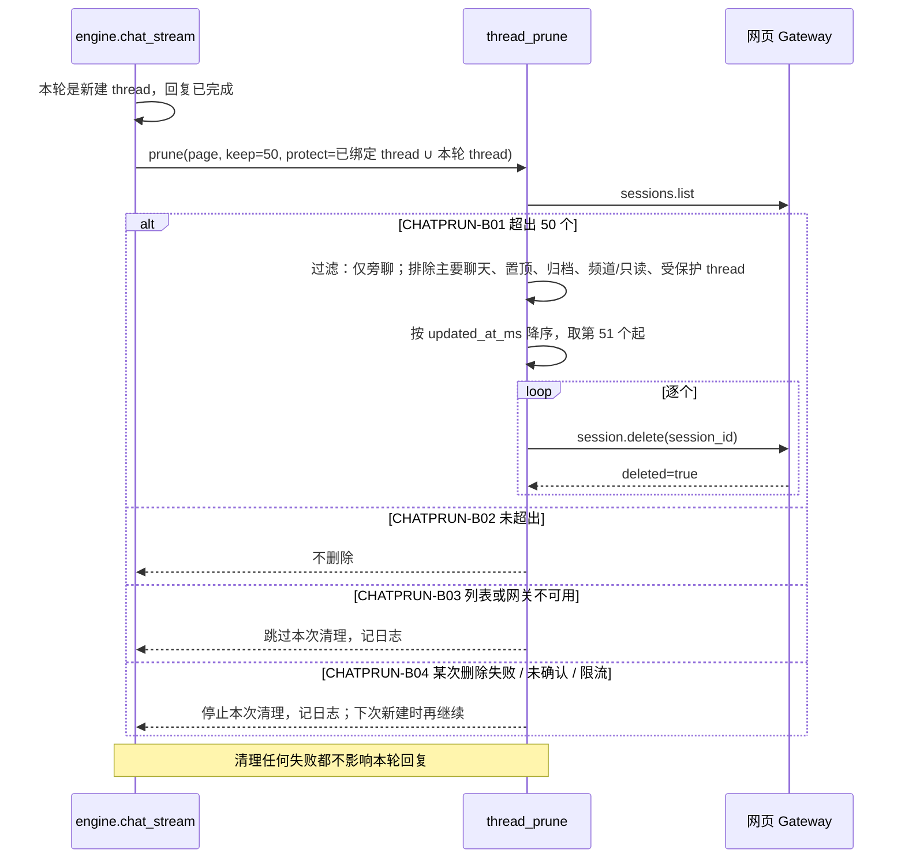

# 旁聊数量清理（CHATPRUN）

## 概述

每个 Muse 账号左侧「旁聊」越积越多。本服务新建 thread 时顺带清理：同一账号只保留最后活动时间最新的 50 个旁聊，其余**永久删除**（不可恢复）。

已与用户对齐（2026-11-12）：

1. 永久删除（`session.delete`），不归档；
2. 范围：账号下所有旁聊（含网页手动建的）；不删、不计数：主要聊天、置顶、被 Claude 会话绑定的 thread；
3. 排序：`updated_at_ms`（最后活动时间）；
4. 时机：现在手动清一次存量；之后每次新建 thread 时增量清理。

研究依据（只读，未删除）：网页 Gateway `sendRequest("sessions.list", {include_peer_sidechats:true})` 一次返回全部 session，字段含 `session_id / updated_at_ms / is_primary / is_thread / pinned / archived / channel / read_only_reason`；`sendRequest("session.delete", {method:"/api/session/delete", session_id})` 成功返回 `deleted === true`；无批量接口；URL `/thread/<uuid>` 的 uuid 即 `session_id`。

## 时序图

## 分支表

| ID | 分支 | 状态 | 代码位置 | 测试 | 终态 / 下一步 | 不变量 | 确认方 |
|---|---|---|---|---|---|---|---|
| CHATPRUN-B01 | 超出 50 个时删除最旧的旁聊 | implemented | thread_prune.py:deletion_candidates / prune | tests/test_thread_prune.py::test_keeps_newest…, test_protected_kinds…, test_prune_deletes_beyond_limit | 账号旁聊 ≤ 50（不含保护项） | 主要聊天、置顶、归档、频道/只读、受保护 thread 永不删除；按 updated_at_ms 保留最新 50 | user |
| CHATPRUN-B02 | 未超出不删除 | implemented | thread_prune.py:deletion_candidates | test_under_limit_deletes_nothing | 不变 | 不发删除请求 | user |
| CHATPRUN-B03 | 列表或网关不可用时跳过 | implemented | thread_prune.py:prune；app.py:_prune_side_chats | test_list_failure_skips | 跳过 | 不影响本轮回复 | model:清理是附带动作，失败不应让对话失败 |
| CHATPRUN-B04 | 删除失败、未确认或限流时停止 | implemented | thread_prune.py:prune | test_unconfirmed_delete_stops | 停止，下次新建时继续 | 未确认 deleted=true 不算删除；遇错不继续删 | model:无法确认结果时继续批量删除风险更高 |
| CHATPRUN-B05 | 只在新建 thread 时触发 | implemented | app.py:safe_chat_stream worker（仅 thread_id 为空时调用）；单次最多删 5 个 | test_incremental_cap | 续轮不清理 | 续接已绑定 thread 时不调用清理 | user |
| CHATPRUN-B06 | 存量一次性手动清理 | implemented | app.py:POST /admin/accounts/{aid}/threads/prune（默认 dry_run） | test_dry_run_deletes_nothing | 账号旁聊 ≤ 50 | 用同一套过滤与保护规则 | user |

## 关联流程（边界分支）

- CHATSESS：已绑定的 thread 列为受保护项；若用户在网页上手动删除，CHATSESS-B05 会报错。
- CHATSRC：清理在本轮回复完成之后执行，不影响首字和事件采集。

## 待确认问题 / 待决策

无。

## 变更记录

| 日期 | 任务 | 变更的分支 ID |
|---|---|---|
| 2026-11-12 | B06 真实执行：账号 9c93a37a1374 删除 91 个、保留 50 个，复查 planned=0 | CHATPRUN-B06 |
| 2026-11-12 | 实现 B01–B06，脚本测试通过；真实账号未验证 | CHATPRUN-B01..B06 |
| 2026-11-12 | 对齐需求并登记分支 | CHATPRUN-B01、CHATPRUN-B02、CHATPRUN-B03、CHATPRUN-B04、CHATPRUN-B05、CHATPRUN-B06 |
