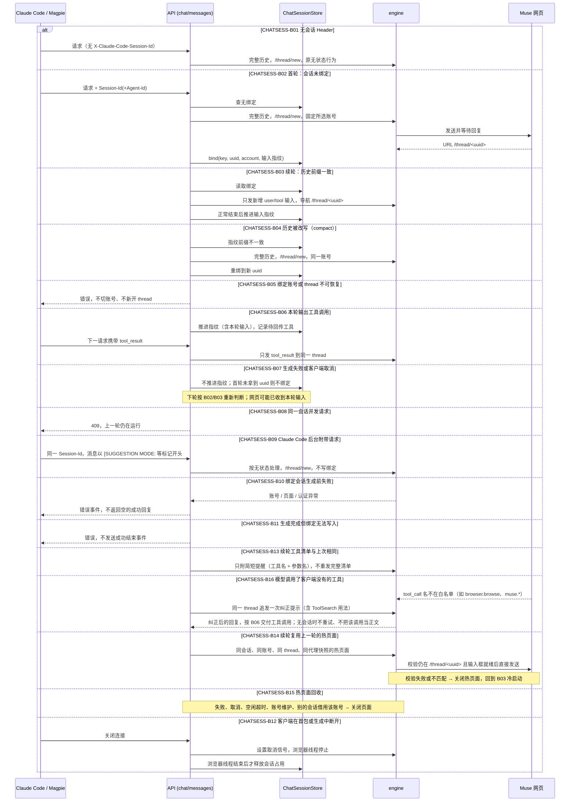

# Claude 会话绑定 Muse thread（CHATSESS）

## 概述

Claude Code 经 Magpie（`baseAPI: chat`，`passHeaders` 透传 `X-Claude-Code-Session-Id` / `X-Claude-Code-Agent-Id`）调用本服务。同一个 Claude 会话（含子代理维度）固定到一个 Muse 账号和一个 Muse thread：首轮新建并绑定，后续只发送新增输入。`/v1/chat/completions` 与 `/v1/messages` 共用同一套绑定逻辑。

已与用户对齐（2026-11-12）：

1. 两个端点共用绑定逻辑，Magpie 只加 `passHeaders`，不改 `baseAPI`；
2. 历史被改写（`/compact`、自动压缩）时，自动新开 thread 发送完整历史并重绑；
3. 已绑定 thread / 账号恢复失败时报错，不切账号、不新开 thread；
4. `424a43ce-c2e9-4a30-82de-d35311f33b5c` 只作验证样本，不提供手动绑定入口。
5. Claude Code 的后台附带请求（如 `[SUGGESTION MODE:`）按特征识别，走无状态，不写入绑定 thread（2026-11-12 追加）；
6. 绑定会话的错误必须如实报给客户端；绑定写入失败不能返回成功；取消必须传到浏览器线程（2026-11-12 追加）。

## 时序图

## 分支表

| ID | 分支 | 状态 | 代码位置 | 测试 | 终态 / 下一步 | 不变量 | 确认方 |
|---|---|---|---|---|---|---|---|
| CHATSESS-B01 | 无会话 Header 保持无状态 | done | chat_sessions.py:122; app.py:1013 | tests/test_chat_sessions.py::CHATSESS_B01 | 新 thread，不写绑定 | 不写 store；行为与改动前一致 | user |
| CHATSESS-B02 | 首轮新建 thread 并绑定 | done | chat_sessions.py:143; app.py:1061; engine.py:1803 | tests/test_chat_sessions.py::CHATSESS_B02 | 绑定 ready | 只有拿到 URL uuid 才写绑定；记录账号 | user |
| CHATSESS-B03 | 续轮只发新增输入到同一 thread | done | chat_sessions.py:139; app.py:1013 | tests/test_chat_sessions.py::CHATSESS_B03 | 指纹推进 | 只发新增 user/tool；不重发 system/assistant；原样重发时只发最后一条 | user |
| CHATSESS-B04 | 历史改写后新开 thread 重绑 | done | chat_sessions.py:135 | tests/test_chat_sessions.py::CHATSESS_B04 | 绑定替换为新 uuid | 发送完整历史；账号不变 | user |
| CHATSESS-B05 | 绑定恢复失败报错 | done | app.py:1013; engine.py:801 | tests/test_chat_session_endpoints.py::CHATSESS-B05 | 错误，绑定保留 | 不切账号、不新开 thread | user |
| CHATSESS-B06 | 工具调用与工具结果回传 | done | chat_sessions.py:139 | tests/test_chat_sessions.py::CHATSESS_B06 | 指纹推进 | tool_result 只发到同一 thread | model:Claude 回传 tool_result 为新输入，与 B03 同一增量规则 |
| CHATSESS-B07 | 失败或取消不推进 | done | app.py:1061 | tests/test_chat_sessions.py::CHATSESS_B07 | 绑定保持上次成功状态 | 失败不推进指纹；首轮失败不绑定 | model:未完成的轮次不能作为已同步历史 |
| CHATSESS-B09 | 后台附带请求不写入绑定 thread | done | app.py:1013; app.py:1082 | tests/test_chat_session_endpoints.py::CHATSESS-B09 | 无状态新 thread | 不调用绑定 thread；不改指纹；之后主对话仍续接原 thread | user |
| CHATSESS-B10 | 绑定会话生成前失败如实报错 | done | app.py:506; app.py:514 | tests/test_safe_chat_stream_session.py::CHATSESS_B10_pinned_auth_error_is_raised | 错误事件 | 不返回空成功；不推进绑定 | user |
| CHATSESS-B11 | 绑定写入失败不返回成功 | done | app.py:1061 | tests/test_chat_session_endpoints.py::CHATSESS-B11 | 错误事件 | 有 message_stop / [DONE] 必然已写入绑定 | user |
| CHATSESS-B12 | 断开时取消浏览器线程后再释放占用 | done | app.py:555; app.py:559; app.py:1061; chat_transport.py:66; chat_transport.py:100; chat_sessions.py:97; chat_sessions.py:143 | tests/test_chat_cancel.py::CHATSESS_B12 | 会话占用释放 | 释放占用前浏览器线程已停止；首包后断开也释放；占用有 owner token，旧请求不能清掉新请求的占用、也不能写入绑定；调用方提前关闭时立即叫停浏览器线程 | user |
| CHATSESS-B13 | 续轮工具清单不变只发简短提醒 | done | app.py:1122; tool_protocol.py:247; chat_sessions.py:152 | tests/test_chat_session_endpoints.py::CHATSESS-B13 | 续轮提示词从约 7 万字降到约 1 千字 | 只在 continue 且清单指纹等于该 thread 上次成功发送的指纹时用提醒；新建、重绑、清单变化时发完整清单；失败轮次不更新指纹 | model:同一 thread 前文已有完整定义，重复发送只增加噪声和延迟 |
| CHATSESS-B14 | 续轮复用上一轮的热页面 | done | app.py:430; engine.py:833; engine.py:866 | tests/test_chat_page_reuse.py::CHATSESS_B14 | 跳过 40–80 秒的页面加载（实测 65 s → 5 ms） | 只在 continue 且账号、thread、代理快照全部一致时复用；复用前校验 URL 仍为该 thread、输入框就绪；不满足即关闭并冷启动 | user |
| CHATSESS-B15 | 热页面回收 | done | engine.py:893; app.py:3509; app.py:230 | tests/test_chat_page_reuse.py::CHATSESS_B15 | 页面与 BrowserContext 释放 | 失败 / 取消 / 绑定未写入的轮次不保留页面；空闲超时关闭；同账号被其他会话或维护操作使用前关闭；每个账号最多一个热页面 | model:与原每轮关页的隔离语义一致，只在明确匹配时延长生命周期 |
| CHATSESS-B16 | 模型调用客户端没有的工具时纠正一次 | done | app.py:1186; app.py:1140; tool_protocol.py:414; tool_protocol.py:248 | tests/test_chat_session_endpoints.py::CHATSESS-B16 | 客户端拿到白名单内的工具调用，或正文 | 执行不了的调用不进正文、不进 tool_calls；纠正只在绑定会话、同一 thread 内重试一次；续轮提醒保留延迟加载说明 | model:真实会话中续轮提醒丢了延迟加载说明，模型改调 browser.browse，客户端收到的是无法执行的正文 |
| CHATSESS-B08 | 同会话并发拒绝 | done | chat_sessions.py:97; app.py:1013 | tests/test_chat_sessions.py::CHATSESS_B08 | 409 | 同一 key 同时只有一个请求；ttl=timeout+60 兜底 | model:并发写同一 thread 会让增量错位 |

## 关联流程（边界分支）

- CHATMSG：Messages 的文本 / 工具输出不变，仅输入侧改为增量；CHATMSG-B08 由本流程取代。
- CHATPRUN：清理在热页面上执行；保护集合包含本轮 thread，复用不影响清理规则。

## 待确认问题 / 待决策

无。B07 中"网页已收到但未完成的输入"不会回滚；下轮由 Claude 重发时作为新增输入再次送达，属于已知取舍。

## 变更记录

| 日期 | 任务 | 变更的分支 ID |
|---|---|---|
| 2026-11-12 | 修复：续轮提醒丢失延迟加载说明；未知工具调用在同一 thread 纠正一次 | CHATSESS-B13、CHATSESS-B16 |
| 2026-11-12 | 实现热页面复用与回收；真实 claude 三轮工具调用验证续轮首字 2–8 秒 | CHATSESS-B14、CHATSESS-B15 |
| 2026-11-12 | 登记热页面复用与回收 | CHATSESS-B14、CHATSESS-B15 |
| 2026-11-12 | 精简工具提示词：紧凑 Schema、续轮简短提醒 | CHATSESS-B13 |
| 2026-11-12 | 对齐需求并登记会话绑定分支 | CHATSESS-B01..B08 |
| 2026-11-12 | 复核：CHATSRC 改动 engine.py，B02 的 thread 回报移入 _report_thread，B05 行号变化，行为不变 | CHATSESS-B02、CHATSESS-B05 |
| 2026-11-12 | 补齐审查缺陷：真实工作线程报错测试、写入绑定校验占用 token、提前关闭不卡到总时限 | CHATSESS-B10、CHATSESS-B12 |
| 2026-11-12 | 实现附带请求识别、错误如实上报、绑定写入失败报错、取消等待浏览器线程 | CHATSESS-B08、CHATSESS-B09、CHATSESS-B10、CHATSESS-B11、CHATSESS-B12 |
| 2026-11-12 | 登记附带请求与审查缺陷分支 | CHATSESS-B09、CHATSESS-B10、CHATSESS-B11、CHATSESS-B12 |
| 2026-11-12 | 实现 ChatTurn 共用绑定、Magpie passHeaders；真实两轮验证同一 thread | CHATSESS-B01、CHATSESS-B02、CHATSESS-B03、CHATSESS-B04、CHATSESS-B05、CHATSESS-B06、CHATSESS-B07、CHATSESS-B08 |
