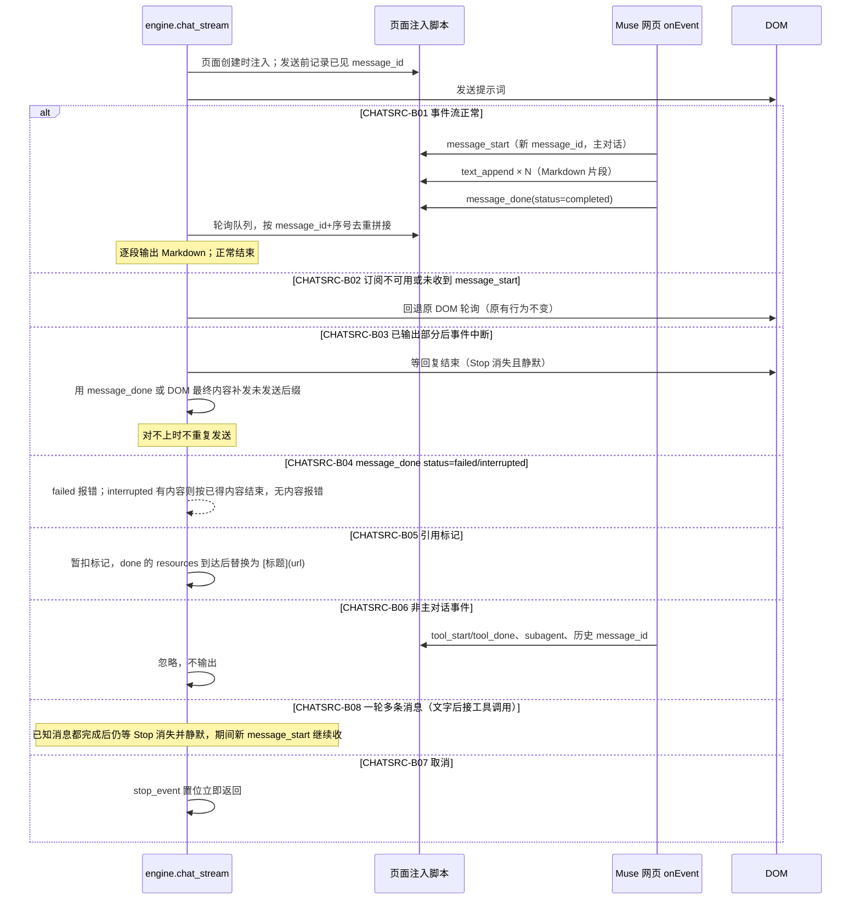

# 网页回复采集（CHATSRC）

## 概述

`engine.chat_stream` 发送提示词后，从 Muse 网页取得助手回复增量。新增主路径：页面注入脚本，经 React context 中网页自带的 `onEvent` 订阅 `delta.message_start / text_append / message_done`，事件进页面内有界队列，Python 轮询读取；`text_append.text` 是 Markdown 原文。原 DOM 轮询保留为兜底。

已与用户对齐（2026-11-12）：

1. 事件通道中途失效：不混用 DOM 增量；回复结束后从 `message_done` 或页面最终内容补发未发送的后缀，对不上时宁可少发不重复；
2. 引用标记（`【cite:id】` 等）转成 Markdown 链接 `[标题](url)`；标记先暂扣，`message_done` 的 `resources` 到达后补上；
3. Muse 内部工具事件（搜索、沙箱）不输出；
4. 允许在真实账号上发少量测试消息验证。

研究依据（只读，未发消息）：Muse 前端 bundle 中 `chat.stream` 为 Noise 加密 WebSocket；解密后事件形如 `{type:"event", event, payload}`，由 React context 的 `onEvent(name, cb)` 分发，回调为 `(payload, meta)`。

## 时序图

## 分支表

| ID | 分支 | 状态 | 代码位置 | 测试 | 终态 / 下一步 | 不变量 | 确认方 |
|---|---|---|---|---|---|---|---|
| CHATSRC-B01 | 事件流输出 Markdown 增量 | done | muse_events.py:19; muse_events.py:147; engine.py:522; engine.py:1703; engine.py:1819 | tests/test_chat_events.py::CHATSRC_B01_engine_streams_markdown_before_dom | 正常结束 | 拼接内容 = 已收到增量（done 带完整文本且以增量为前缀时用它补齐）；按 message_id+序号去重 | user |
| CHATSRC-B02 | 事件不可用回退 DOM | done | engine.py:1703; engine.py:1813; engine.py:1850 | tests/test_chat_events.py::CHATSRC_B02_no_subscription_falls_back_to_dom | DOM 路径结束 | 只在尚未输出时回退；回退时行为与改动前一致 | user |
| CHATSRC-B03 | 事件中途中断后补齐 | done | engine.py:1874; muse_events.py:223 | tests/test_chat_events.py::CHATSRC_B03_events_stop_midway_dom_fills_tail | 结束 | 只补以已发内容为前缀的后缀；不重复发送 | user |
| CHATSRC-B04 | done 状态 failed / interrupted | done | muse_events.py:147; engine.py:1845 | tests/test_chat_events.py::CHATSRC_B04_failed_raises | failed 报错；interrupted 有内容按已得内容结束，无内容报错 | failed 不当成功 | model:Muse 前端对 failed 显示错误、interrupted 保留部分内容 |
| CHATSRC-B05 | 引用转 Markdown 链接 | done | muse_events.py:76; muse_events.py:89; muse_events.py:188 | tests/test_chat_events.py::CHATSRC_B05_citation_to_markdown_link | 链接到达正文 | 只接受 http(s) 链接；l.meta.ai 包装解包；无对应资源时去掉标记 | user |
| CHATSRC-B06 | 忽略非主对话与工具事件 | done | muse_events.py:81; muse_events.py:147 | tests/test_chat_events.py::CHATSRC_B06_ignores_other_messages | 不输出 | 只认发送后出现 message_start 的主对话 message_id；不订阅 tool 事件 | user |
| CHATSRC-B07 | 取消 | done | engine.py:1819 | tests/test_chat_events.py::CHATSRC_B07_cancel_returns_without_final | 立即返回 | 不调用 on_final_text | model:与 DOM 路径取消语义一致 |
| CHATSRC-B08 | 一轮多条消息：已完成消息后又出现新消息 | done | engine.py:1861 | tests/test_chat_events.py::CHATSRC_B08_waits_for_followup_message | 收齐全部消息后结束 | 已知消息全部 done 不等于本轮结束；需 Stop 消失并静默 ≥1s（工具请求 4s） | model:真实故障——首条文字 done 即结束，丢掉随后的 tool_call，Claude Code 停在开场白 |

## 关联流程（边界分支）

- CHATMSG：消费 `engine.chat_stream` 的增量与 `on_final_text`；本流程只改增量来源与格式，不改协议输出。
- CHATSESS：`on_thread` 回报 thread ID 的时机不变。

## 待确认问题 / 待决策

无。

实测（2026-11-12，真实账号）：
- 带标题、列表、代码块、表格的回复经事件流输出，格式完整保留（`source_events=1`）；
- 实测 `message_done` 不带 `display_text` / `content`，最终文本在 `transcript` 字段，形状未解析；因此补齐依赖已收到的增量或 DOM 兜底；
- 未遇到带引用资源的回复，B05 只有离线测试。

## 变更记录

| 日期 | 任务 | 变更的分支 ID |
|---|---|---|
| 2026-11-12 | 修复：首条消息完成即结束导致后续工具调用丢失 | CHATSRC-B08 |
| 2026-11-12 | 实现事件流采集、DOM 兜底；真实账号验证 Markdown 保留 | CHATSRC-B01、CHATSRC-B02、CHATSRC-B03、CHATSRC-B04、CHATSRC-B05、CHATSRC-B06、CHATSRC-B07 |
| 2026-11-12 | 对齐需求并登记分支 | CHATSRC-B01、CHATSRC-B02、CHATSRC-B03、CHATSRC-B04、CHATSRC-B05、CHATSRC-B06、CHATSRC-B07 |
